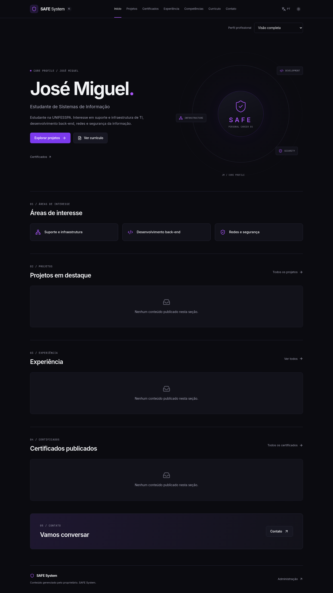
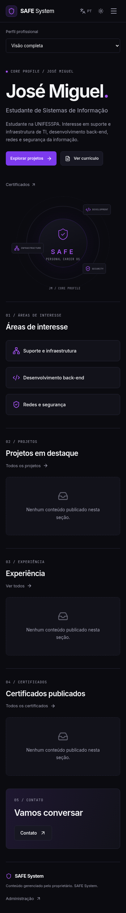

# SAFE System — Personal Career Operating System

Portfólio bilíngue de José Miguel e painel privado de carreira. Um administrador; nenhum cadastro público ou multi-tenant. Projetos, certificados, experiências, competências, currículos por upload, perfis de apresentação, cursos, candidaturas com histórico e analytics agregado são persistidos na API. O front-end não usa um catálogo fictício como banco de dados.

## Stack e estrutura

React 19, TypeScript estrito, Vite 8, React Router, Tailwind 4, Radix Dialog, TanStack Query, React Hook Form/Zod, Lucide e i18next. API: Java 21, Spring Boot 4.0.8, Spring Security, JPA, Bean Validation, PostgreSQL 17, Flyway, OpenAPI, PDFBox e AWS S3 SDK.

```text
apps/web/          # SPA, layouts públicos/privados e formulários
apps/api/          # monólito modular Spring Boot
infra/docker/      # imagem Java não-root
infra/development/ # provisionamento local explícito
infra/deployment/  # configuração Vercel
.github/workflows/ # CI e fluxos de navegador
 docs/             # arquitetura, contratos, operação e roadmap
```

## Acessar pela internet

O repositório contém o código; o site precisa de hospedagem. Siga [o roteiro de publicação no Railway](docs/PUBLISH-RAILWAY.md) para criar o serviço, conectar PostgreSQL e armazenamento privado, e obter seu link de acesso. O painel estará em `/admin/login` no mesmo endereço do portfólio.

## Executar localmente

Na máquina Codex preparada, `bash infra/development/cloud-start.sh` reutiliza o banco existente e inicia os processos. Os passos Compose a seguir atendem uma instalação local.

Requisitos: **JDK 21 completo** (não apenas JRE), Node 24, Docker Compose e Python 3 para o helper opcional. Maven 3.9.11 pode ser usado pelo wrapper.

1. `python3 infra/development/init-local.py` gera `.local/dev.env` com senhas aleatórias locais; não altera configurações existentes.
2. Configure seu `.env` a partir de `.env.example`, ou use as variáveis locais:

```bash
set -a
source .local/dev.env
set +a
docker compose --env-file .local/dev.env up -d postgres
cd apps/api
./mvnw spring-boot:run
```

Em outro terminal, na raiz do checkout:

```bash
cd apps/web
npm ci
npm run dev
```

A API usa porta 8080; Vite usa 5173 com proxy `/api`. Verifique a resposta JSON `status: UP` de `/actuator/health` e o perfil em `/api/v1/public/profile`. A interface pública inicia em `/pt-BR`; o painel, em `/admin/login`.

Para executar a API em Docker: `docker compose --env-file .local/dev.env up --build -d api`. Os uploads locais estão no volume `files`; os dados do banco, no volume `postgres-data`. Volumes Docker e processos podem não sobreviver à restauração de uma máquina na nuvem: use backups antes de trocar de ambiente.

O administrador é provisionado **somente** quando `ADMIN_USERNAME` e `ADMIN_PASSWORD` são fornecidos e o banco ainda não possui administrador. A senha exige pelo menos 12 caracteres e no máximo 72 bytes UTF-8. O helper é explicitamente para desenvolvimento. Nunca use essas credenciais em produção. Consulte `.local/dev.env` no seu ambiente para a conta local; valores não são registrados em logs ou documentação.

## Testar e construir

Os testes da API usam um **banco dedicado `safe_test`** e truncam suas tabelas de conteúdo. Não aponte `TEST_DATABASE_URL` para dados reais.

```bash
# Com PostgreSQL disponível e variáveis de acesso carregadas:
docker compose exec postgres psql -U safe -d safe -c 'CREATE DATABASE safe_test;'
cd apps/api
./mvnw verify
./mvnw fmt:check
# Em apps/web:
npm test
npm run lint
npm run build
```

Playwright requer API e Vite em execução, Chromium e `ADMIN_USERNAME`/`ADMIN_PASSWORD` de uma conta explicitamente criada em um banco E2E isolado. `npm run test:e2e` executa os dez fluxos solicitados em uma jornada, além de idioma/tema/mobile/teclado. Use `CHROMIUM_PATH` para o executável instalado. Os registros criados são identificados como E2E; não execute contra produção.

O script `npm run prerender`, após o build e com a API disponível, gera HTML público PT-BR/EN e detalhes publicados. Configure `VITE_SITE_URL` **antes do build** para canonical/hreflang/sitemap. A atualização do conteúdo continua dinâmica no navegador; os HTMLs precisam ser regenerados ao publicar conteúdo para atualizar os snapshots de SEO. Nenhuma página administrativa é pré-renderizada.

## Segurança e conteúdo

Sessão HttpOnly, CSRF inclusive no login, BCrypt, expiração de 30 minutos, limitação de login, CORS explícito, erros sem stack traces e restrição de endpoints no servidor. Apenas conteúdos publicados aparecem na API pública. IDs de documentos privados não concedem acesso. PDFs são analisados com PDFBox e conteúdos ativos/anexos são rejeitados; imagens são verificadas por assinatura e decodificação com limites de dimensões. Limite de upload: 10 MB. Isso não substitui antimalware.

O conteúdo inicial se limita ao nome, formação e interesses fornecidos, além das três categorias de apresentação. Não há experiências com datas inventadas, certificados fictícios, URLs presumidas ou gráficos simulados. JBS, ExceptionJR e projetos conhecidos podem ser cadastrados pelo proprietário com as informações confirmadas.

## Deploy e evidências

Leia [DEPLOYMENT](docs/DEPLOYMENT.md), [ARCHITECTURE](docs/ARCHITECTURE.md), [API](docs/API.md), [DEVELOPMENT](docs/DEVELOPMENT.md), [VALIDATION](docs/VALIDATION.md) e [ROADMAP](docs/ROADMAP.md). A especificação original está em [SPECIFICATION](docs/SPECIFICATION.md).

O estado implementado e os resultados reais estão documentados em `docs/VALIDATION.md`; implantação externa, domínio e integração com um bucket de produção só podem ser afirmados após configuração e testes reais.

## Screenshots do estado inicial real





As imagens representam o banco de desenvolvimento sem projetos/certificados cadastrados; nenhum exemplo E2E foi usado como conteúdo profissional.
