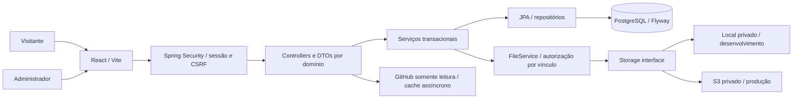

# Arquitetura

## Decisões

Monólito modular com PostgreSQL como fonte da verdade, DTOs específicos e serviços transacionais por domínio. Controllers apenas encaminham entradas validadas. Não há registro público nem camada CRUD genérica na API. O editor web compartilha apresentação de campos, enquanto o contrato e a validação de cada domínio permanecem explícitos no servidor.

`apps/web/src` separa router, layouts, páginas, UI, features, hooks, API, i18n, tipos e estilos. Rotas são carregadas por `React.lazy`. TanStack Query gerencia cache e invalidação após gravação. O público usa `/pt-BR` e `/en`; idioma e tema persistem, sem credenciais em localStorage.

A API organiza packages `project`, `certificate`, `experience`, `skill`, `resume`, `course`, `jobapplication`, `professionalprofile`, `file`, `settings`, `analytics`, `github`, `security`, `common` e `publicapi`. Campos de auditoria são compartilhados em `AuditedEntity`; não há microserviços.

## Dados

As migrations implementam todas as entidades centrais da especificação. Traduções são coleções JPA em tabelas próprias, com PK `(resource_id, locale)` e constraints PT-BR/EN. Competências, perfis/projetos e mídias possuem tabelas de vínculos, UUIDs e FKs. Slugs são únicos; certificado recebeu slug para sua rota pública. Datas de atualização são auditadas. Um índice parcial garante apenas um currículo principal por idioma.

`site_settings` usa pares de chave/valor limitados a um DTO conhecido; não aceita configuração arbitrária, segredos ou HTML executável. Currículos são exclusivamente PDFs enviados; não há gerador.

Exclusão de um conteúdo remove traduções/vínculos e histórico dependente por FK. Arquivos referenciados bloqueiam exclusão. Remoção de competência ainda vinculada, ou de projeto utilizado por um perfil, retorna 409: desvincule primeiro. Certificados/currículos removidos desvinculam referências opcionais de curso/perfil/candidatura conforme a migration. Arquivos órfãos não são apagados automaticamente por remoção de conteúdo.

Paginação é feita no banco. Specification combina publicação, título, categoria, status, competência e perfil; busca escapa `%`, `_` e `\`. Ordenação é uma enumeração controlada. Há batch fetch para coleções lazy; DTOs copiam as coleções dentro da transação. Nenhuma entidade JPA é serializada pelo controller.

## Autenticação

1. O cliente obtém token CSRF em `GET /api/v1/auth/csrf`, com sessão anônima quando necessário.
2. Login envia token e credenciais no corpo HTTPS. Spring Security verifica BCrypt; a API limita tentativas por endereço em janela de 15 minutos.
3. Login troca o ID da sessão, salva o contexto de segurança e invalida o token CSRF anterior.
4. O cookie é HttpOnly, SameSite=Lax, Secure em produção. Cada mutação usa o novo token, sem autenticação em localStorage.
5. Logout invalida a sessão e limpa o contexto. Todas as rotas `/admin/**` exigem ADMIN no servidor.

O banco impõe um único administrador. Provisionamento explícito ocorre apenas quando a tabela está vazia. As variáveis podem ser removidas após criação. Sessões são locais ao processo: uma única instância é a configuração inicial suportada; múltiplas instâncias precisam de Spring Session/Redis ou afinidade de sessão cuidadosamente configurada.

## Arquivos

Uploads privados usam UUID como chave interna, SHA-256 e metadados separados. Verificação de extensão, MIME, assinatura e parsing: PDFBox para PDFs não criptografados, sem ações/anexos; ImageIO/TwelveMonkeys para JPG/PNG/WebP. Limites: 10 MB, imagens até 8000 px por dimensão e 32 megapixels, PDFs até 1000 páginas.

A autorização pública é calculada no momento do acesso: currículo/certificado publicado ou mídia de projeto publicado. Nenhuma flag isolada de arquivo permite bypass. LocalStorage de servidor mantém arquivos fora dos recursos estáticos. S3 utiliza bucket privado e URLs assinadas de dois minutos.

Exclusão de arquivo desvinculado remove os metadados e insere uma tarefa de limpeza na mesma transação. Um job tenta apagar o objeto a cada minuto e conserva tarefas com falha. A expiração de URLs assinadas já emitidas é um risco residual documentado: ocultar conteúdo bloqueia novos acessos na API, mas uma URL anterior pode durar até dois minutos. Não há alegação de antivírus completo; adicioná-lo antes de abrir upload a terceiros.

## Integrações, métricas e SEO

GitHub só consulta URLs HTTPS selecionadas em projetos publicados, de um host fixo. A resposta principal é imediata com os links manuais; consultas externas ocorrem em dois workers, com timeouts e cache de 15 minutos inclusive em falhas. Mudanças de publicação removem seleções da resposta imediatamente. Repositórios privados nunca são enriquecidos.

Analytics é opt-in na configuração administrativa: contadores por dia, página e tipo, sem IP em banco, identidade, notas ou user agent. Proteção antispam usa estado efêmero em memória. Estatísticas representam eventos registrados, não visitantes únicos nem uma medição inviolável de tráfego.

A SPA tem titles/metas por rota. A pré-renderização opcional cria HTML do conteúdo público real e gera sitemap/canonical/hreflang quando o domínio é configurado. Exige rebuild/redeploy para refletir alterações de conteúdo no HTML estático; a API continua atualizando o navegador. Administração é excluída de robots e possui X-Robots-Tag no deploy Vercel.

Inter e JetBrains Mono são servidas localmente via pacotes Fontsource; licenças estão nos assets públicos, sem dependência de um serviço externo de fontes.
